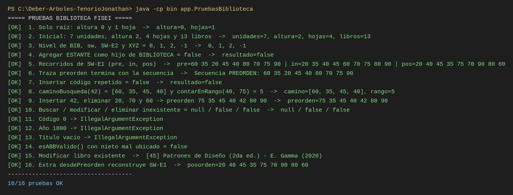

# Deber-Arboles-TenorioJonathan

**Catálogo de la Biblioteca FISEI con árbol general y ABB en Java**

| | |
|---|---|
| Estudiante | Tenorio Ronquillo Jonathan Sebastián |
| Asignatura | Estructura de Datos — Tercero "B", Ingeniería de Software (FISEI – UTA) |
| Docente | Ing. José Caiza, Mg. |
| Actividad | APE 3 · Deber individual |
| Herramientas | Java 17+, Visual Studio Code, GitHub |

## 1. Problema

La Biblioteca FISEI se organiza en **Áreas** y cada Área en **Estantes**. Esa jerarquía se representa con un
**árbol general n-ario** (`ArbolBiblioteca`), donde solo se permite la relación
`BIBLIOTECA → AREA → ESTANTE`.

Cada Estante guarda sus libros en un **Árbol Binario de Búsqueda** (`CatalogoABB`) ordenado por el código del
libro (entero positivo, sin repetidos): los códigos menores van a la izquierda y los mayores a la derecha.

```
BIB Biblioteca FISEI
├── SW Software
│   ├── SW-E1 Estante 1 de Software → 60, 35, 80, 20, 45, 70, 90, 40, 75
│   └── SW-E2 Estante 2 de Software → 15, 10, 25
├── TI Tecnologías de la Información
│   └── TI-E1 Estante 1 de TI → 50
└── TEL Telecomunicaciones
```

7 unidades · 4 hojas · altura 2 (aristas) · 13 libros.

Todas las operaciones de los árboles son **recursivas** y no se usan `TreeSet`, `TreeMap`, `PriorityQueue`,
`NavigableSet`, `NavigableMap`, `Collections.sort` ni `List.sort`.

## 2. Estructura del proyecto

```
src/
├── enums/    TipoUnidad.java, TipoRecorrido.java
├── modelo/   Libro.java, UnidadBiblioteca.java
├── negocio/  NodoUnidad.java, NodoLibro.java, ArbolBiblioteca.java, CatalogoABB.java
└── app/      Main.java, DatosPrueba.java, PruebasBiblioteca.java
TRAZAS.md     ABB resuelto a mano con los códigos personales
```

| Clase | Responsabilidad |
|---|---|
| `TipoUnidad` | BIBLIOTECA, AREA, ESTANTE y la regla `puedeTenerHijo` |
| `TipoRecorrido` | PREORDEN, INORDEN, POSORDEN |
| `Libro` | código (sin setter, > 0), título, autor y año 1900–2026 con validaciones |
| `UnidadBiblioteca` | código en mayúsculas, nombre y tipo |
| `NodoUnidad` | unidad, lista de hijos y `CatalogoABB` (solo si es ESTANTE) |
| `NodoLibro` | libro, hijo izquierdo y derecho |
| `ArbolBiblioteca` | agregar, buscar, altura, hojas, nivel, jerarquía y total de libros |
| `CatalogoABB` | insertar, buscar, contar, recorridos, traza, modificar, eliminar y retos |
| `Main` | menú interactivo con `Scanner` |
| `DatosPrueba` | carga la estructura inicial |
| `PruebasBiblioteca` | 16 casos de prueba con resumen `X/N pruebas OK` |

## 3. Instrucciones de ejecución

Requisito: JDK 17 o superior (`java -version`).

### Desde la terminal (Windows PowerShell, Linux o macOS)

```bash
# compilar
javac -encoding UTF-8 -d bin src/enums/*.java src/modelo/*.java src/negocio/*.java src/app/*.java

# menú interactivo
java -cp bin app.Main

# casos de prueba
java -cp bin app.PruebasBiblioteca
```

### Desde Visual Studio Code

1. Instalar el *Extension Pack for Java*.
2. Abrir la carpeta del proyecto (la configuración `.vscode/settings.json` ya marca `src` como carpeta de fuentes).
3. Abrir `src/app/Main.java` o `src/app/PruebasBiblioteca.java` y pulsar **Run**.

### Menú

```
 1. Cargar estructura inicial          7. Buscar libro
 2. Mostrar jerarquía                  8. Modificar libro
 3. Agregar unidad                     9. Eliminar libro
 4. Buscar unidad                     10. Mostrar recorridos con su traza
 5. Altura, hojas, nivel y libros     11. Retos (rango, camino, validar ABB, desde preorden)
 6. Insertar libro en un estante      12. Ejecutar PruebasBiblioteca
 0. Salir
```

## 4. Captura de PruebasBiblioteca



## 5. Decisiones de implementación

- **Eliminar con dos hijos:** se copia el sucesor inorden (mínimo del subárbol derecho) y luego se elimina ese
  sucesor del subárbol derecho, donde tiene a lo sumo un hijo.
- **`contarEnRango(a, b)`:** si el código del nodo es menor que `a` solo se baja a la derecha; si es mayor que
  `b`, solo a la izquierda (poda).
- **`esABBValido()`:** cada nodo recibe un límite mínimo y máximo; así se detectan nietos mal ubicados que una
  comparación solo con el padre no vería.
- **`desdePreorden(int[])` (extra):** reconstruye el ABB en O(n) usando límites y un índice compartido, sin llamar
  a `insertar` por cada valor.
- **`modificar`:** valida todos los datos antes de cambiar el libro, para no dejarlo modificado a medias.
