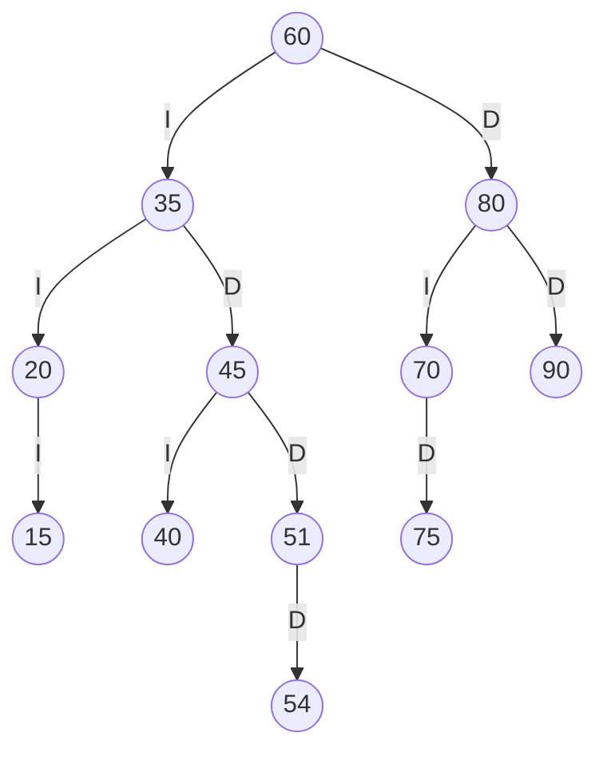
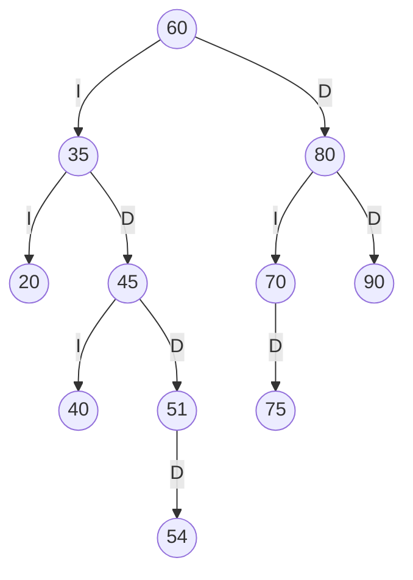
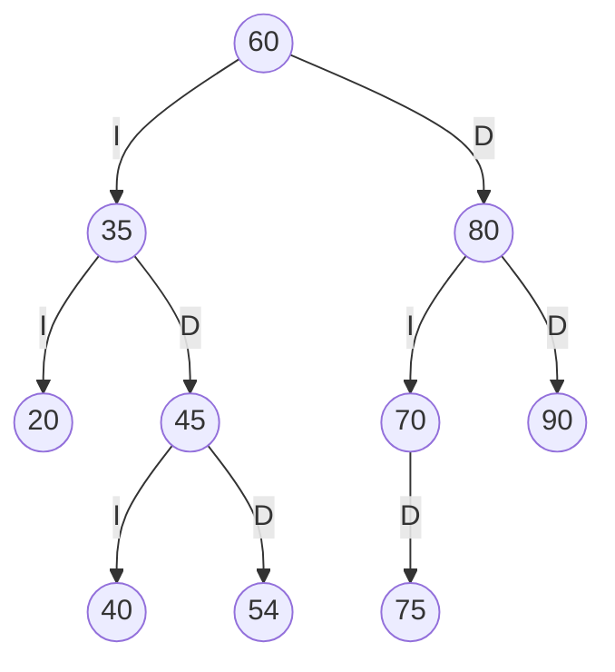
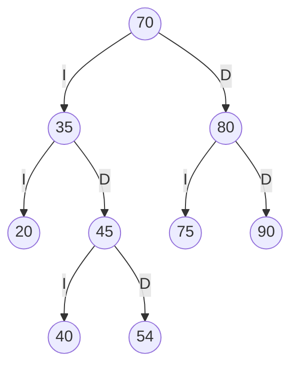

# TRAZAS.md — ABB del Estante SW-E1 resuelto a mano

**Estudiante:** Tenorio Ronquillo Jonathan Sebastián · **Asignatura:** Estructura de Datos · **Docente:** Ing. José Caiza, Mg.

## 1. Códigos personales

Cuatro últimos dígitos de la cédula: **abcd = 5154**

| Par | Dígitos | Valor | Ajuste | Código final |
|---|---|---|---|---|
| ab | 51 | 51 | ninguno | **51** |
| bc | 15 | 15 | ninguno | **15** |
| cd | 54 | 54 | ninguno | **54** |

Códigos personales: **51, 15, 54**

Regla: si un código es 0, se repite o ya existe en el árbol, se le suma 1 (hasta que sea válido).

## 2. Inserción

Secuencia de SW-E1: `60, 35, 80, 20, 45, 70, 90, 40, 75`, y luego los códigos personales en orden.

Recorrido de comparación de cada código personal:

- **51**: 51 < 60 → izquierda; 51 > 35 → derecha; 51 > 45 → derecha → se inserta como hijo **derecho** de 45.
- **15**: 15 < 60 → izquierda; 15 < 35 → izquierda; 15 < 20 → izquierda → se inserta como hijo **izquierdo** de 20.
- **54**: 54 < 60 → izquierda; 54 > 35 → derecha; 54 > 45 → derecha; 54 > 51 → derecha → se inserta como hijo **derecho** de 51.

## 3. ABB final

Aristas: **I** = hijo izquierdo, **D** = hijo derecho.



## 4. Recorridos

| Recorrido | Regla | Secuencia |
|---|---|---|
| Preorden | raíz → izq → der | 60 35 20 15 45 40 51 54 80 70 75 90 |
| Inorden | izq → raíz → der | 15 20 35 40 45 51 54 60 70 75 80 90 |
| Posorden | izq → der → raíz | 15 20 40 54 51 45 35 75 70 90 80 60 |

El inorden sale ordenado de menor a mayor, lo que confirma que el ABB está bien construido.

### Traza del preorden

`entra X` al llegar al nodo, `VISITA X` al procesarlo y `null -> regresa` en cada hijo vacío (2 espacios por nivel).

```text
entra 60
VISITA 60
  entra 35
  VISITA 35
    entra 20
    VISITA 20
      entra 15
      VISITA 15
        null -> regresa
        null -> regresa
      null -> regresa
    entra 45
    VISITA 45
      entra 40
      VISITA 40
        null -> regresa
        null -> regresa
      entra 51
      VISITA 51
        null -> regresa
        entra 54
        VISITA 54
          null -> regresa
          null -> regresa
  entra 80
  VISITA 80
    entra 70
    VISITA 70
      null -> regresa
      entra 75
      VISITA 75
        null -> regresa
        null -> regresa
    entra 90
    VISITA 90
      null -> regresa
      null -> regresa
Secuencia PREORDEN: 60 35 20 15 45 40 51 54 80 70 75 90
```

## 5. Eliminaciones

Se aplican en secuencia sobre el ABB final (cada una parte del árbol que dejó la anterior).

### 5.1 Eliminar 15 — caso hoja

El 15 no tiene hijos: simplemente se quita y su padre apunta a `null`.



Preorden resultante: `60 35 20 45 40 51 54 80 70 75 90`

### 5.2 Eliminar 51 — caso un hijo

El 51 tiene un solo hijo (54): ese hijo sube y ocupa su lugar.



Preorden resultante: `60 35 20 45 40 54 80 70 75 90`

### 5.3 Eliminar 60 — caso dos hijos

El 60 tiene dos hijos: se busca su **sucesor inorden** (el menor del subárbol derecho), que es **70**; se copia 70 en el lugar de 60 y luego se elimina el 70 original del subárbol derecho (allí tiene a lo sumo un hijo derecho).



Preorden resultante: `70 35 20 45 40 54 80 75 90`

## 6. Salida del programa y comparación

Salida obtenida al ejecutar las mismas operaciones con `CatalogoABB` del proyecto:

| Punto | Resultado a mano | Salida del programa | ¿Coincide? |
|---|---|---|---|
| Preorden | 60 35 20 15 45 40 51 54 80 70 75 90 | 60 35 20 15 45 40 51 54 80 70 75 90 | ✅ Coincide |
| Inorden | 15 20 35 40 45 51 54 60 70 75 80 90 | 15 20 35 40 45 51 54 60 70 75 80 90 | ✅ Coincide |
| Posorden | 15 20 40 54 51 45 35 75 70 90 80 60 | 15 20 40 54 51 45 35 75 70 90 80 60 | ✅ Coincide |
| Traza del preorden (última línea) | Secuencia PREORDEN: 60 35 20 15 45 40 51 54 80 70 75 90 | Secuencia PREORDEN: 60 35 20 15 45 40 51 54 80 70 75 90 | ✅ Coincide (traza completa idéntica línea por línea) |
| Eliminar 15 (hoja) → preorden | 60 35 20 45 40 51 54 80 70 75 90 | 60 35 20 45 40 51 54 80 70 75 90 (eliminar = true, ABB válido = true) | ✅ Coincide |
| Eliminar 51 (un hijo) → preorden | 60 35 20 45 40 54 80 70 75 90 | 60 35 20 45 40 54 80 70 75 90 (eliminar = true, ABB válido = true) | ✅ Coincide |
| Eliminar 60 (dos hijos) → preorden | 70 35 20 45 40 54 80 75 90 | 70 35 20 45 40 54 80 75 90 (eliminar = true, ABB válido = true) | ✅ Coincide |

Todos los resultados resueltos a mano coinciden con la salida del programa.
