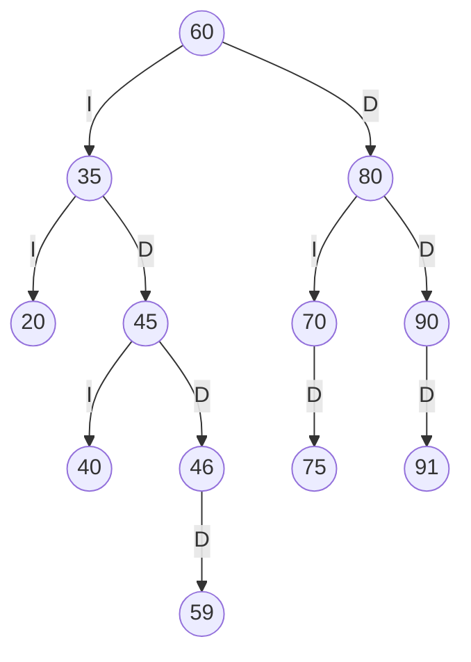
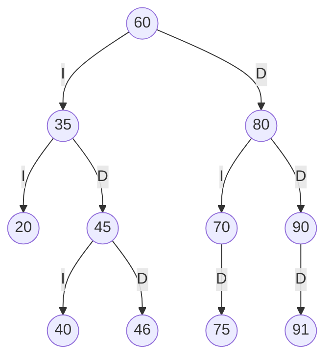
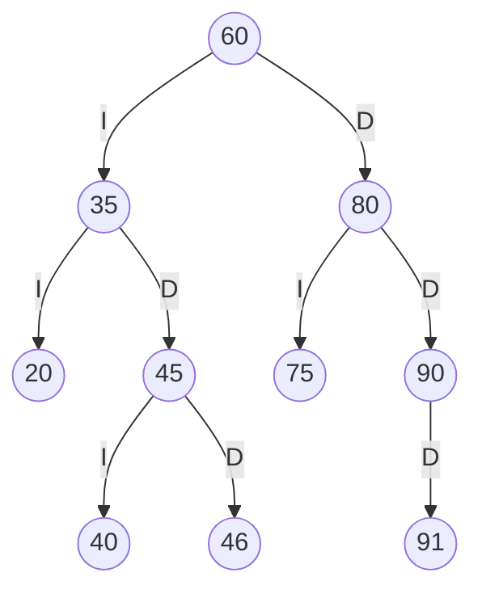
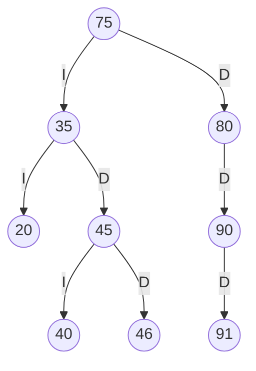

# TRAZAS.md — ABB del Estante SW-E1 resuelto a mano

**Estudiante:** Tenorio Ronquillo Jonathan Sebastián · **Asignatura:** Estructura de Datos · **Docente:** Ing. José Caiza, Mg.

> ⚠️ **IMPORTANTE:** este archivo está generado con los dígitos de ejemplo `4590`. Reemplazarlos por los **4 últimos dígitos de tu cédula** y rehacer los cálculos antes de entregar.

## 1. Códigos personales

Cuatro últimos dígitos de la cédula: **abcd = 4590**

| Par | Dígitos | Valor | Ajuste | Código final |
|---|---|---|---|---|
| ab | 45 | 45 | 45 ya existe en el árbol → +1 | **46** |
| bc | 59 | 59 | ninguno | **59** |
| cd | 90 | 90 | 90 ya existe en el árbol → +1 | **91** |

Códigos personales: **46, 59, 91**

Regla: si un código es 0, se repite o ya existe en el árbol, se le suma 1 (hasta que sea válido).

## 2. Inserción

Secuencia de SW-E1: `60, 35, 80, 20, 45, 70, 90, 40, 75`, y luego los códigos personales en orden.

Recorrido de comparación de cada código personal:

- **46**: 46 < 60 → izquierda; 46 > 35 → derecha; 46 > 45 → derecha → se inserta como hijo **derecho** de 45.
- **59**: 59 < 60 → izquierda; 59 > 35 → derecha; 59 > 45 → derecha; 59 > 46 → derecha → se inserta como hijo **derecho** de 46.
- **91**: 91 > 60 → derecha; 91 > 80 → derecha; 91 > 90 → derecha → se inserta como hijo **derecho** de 90.

## 3. ABB final

Aristas: **I** = hijo izquierdo, **D** = hijo derecho.



## 4. Recorridos

| Recorrido | Regla | Secuencia |
|---|---|---|
| Preorden | raíz → izq → der | 60 35 20 45 40 46 59 80 70 75 90 91 |
| Inorden | izq → raíz → der | 20 35 40 45 46 59 60 70 75 80 90 91 |
| Posorden | izq → der → raíz | 20 40 59 46 45 35 75 70 91 90 80 60 |

El inorden sale ordenado de menor a mayor, lo que confirma que el ABB está bien construido.

### Traza del preorden

`entra X` al llegar al nodo, `VISITA X` al procesarlo y `null -> regresa` en cada hijo vacío (2 espacios por nivel).

```text
entra 60
VISITA 60
  entra 35
  VISITA 35
    entra 20
    VISITA 20
      null -> regresa
      null -> regresa
    entra 45
    VISITA 45
      entra 40
      VISITA 40
        null -> regresa
        null -> regresa
      entra 46
      VISITA 46
        null -> regresa
        entra 59
        VISITA 59
          null -> regresa
          null -> regresa
  entra 80
  VISITA 80
    entra 70
    VISITA 70
      null -> regresa
      entra 75
      VISITA 75
        null -> regresa
        null -> regresa
    entra 90
    VISITA 90
      null -> regresa
      entra 91
      VISITA 91
        null -> regresa
        null -> regresa
Secuencia PREORDEN: 60 35 20 45 40 46 59 80 70 75 90 91
```

## 5. Eliminaciones

Se aplican en secuencia sobre el ABB final (cada una parte del árbol que dejó la anterior).

### 5.1 Eliminar 59 — caso hoja

El 59 no tiene hijos: simplemente se quita y su padre apunta a `null`.



Preorden resultante: `60 35 20 45 40 46 80 70 75 90 91`

### 5.2 Eliminar 70 — caso un hijo

El 70 tiene un solo hijo (75): ese hijo sube y ocupa su lugar.



Preorden resultante: `60 35 20 45 40 46 80 75 90 91`

### 5.3 Eliminar 60 — caso dos hijos

El 60 tiene dos hijos: se busca su **sucesor inorden** (el menor del subárbol derecho), que es **75**; se copia 75 en el lugar de 60 y luego se elimina el 75 original del subárbol derecho (allí tiene a lo sumo un hijo derecho).



Preorden resultante: `75 35 20 45 40 46 80 90 91`

## 6. Salida del programa y comparación

Salida obtenida al ejecutar las mismas operaciones con `CatalogoABB` del proyecto:

| Punto | Resultado a mano | Salida del programa | ¿Coincide? |
|---|---|---|---|
| Preorden | 60 35 20 45 40 46 59 80 70 75 90 91 | 60 35 20 45 40 46 59 80 70 75 90 91 | ✅ Coincide |
| Inorden | 20 35 40 45 46 59 60 70 75 80 90 91 | 20 35 40 45 46 59 60 70 75 80 90 91 | ✅ Coincide |
| Posorden | 20 40 59 46 45 35 75 70 91 90 80 60 | 20 40 59 46 45 35 75 70 91 90 80 60 | ✅ Coincide |
| Traza del preorden (última línea) | Secuencia PREORDEN: 60 35 20 45 40 46 59 80 70 75 90 91 | Secuencia PREORDEN: 60 35 20 45 40 46 59 80 70 75 90 91 | ✅ Coincide (traza completa idéntica línea por línea) |
| Eliminar 59 (hoja) → preorden | 60 35 20 45 40 46 80 70 75 90 91 | 60 35 20 45 40 46 80 70 75 90 91 (eliminar = true, ABB válido = true) | ✅ Coincide |
| Eliminar 70 (un hijo) → preorden | 60 35 20 45 40 46 80 75 90 91 | 60 35 20 45 40 46 80 75 90 91 (eliminar = true, ABB válido = true) | ✅ Coincide |
| Eliminar 60 (dos hijos) → preorden | 75 35 20 45 40 46 80 90 91 | 75 35 20 45 40 46 80 90 91 (eliminar = true, ABB válido = true) | ✅ Coincide |

Todos los resultados resueltos a mano coinciden con la salida del programa.
